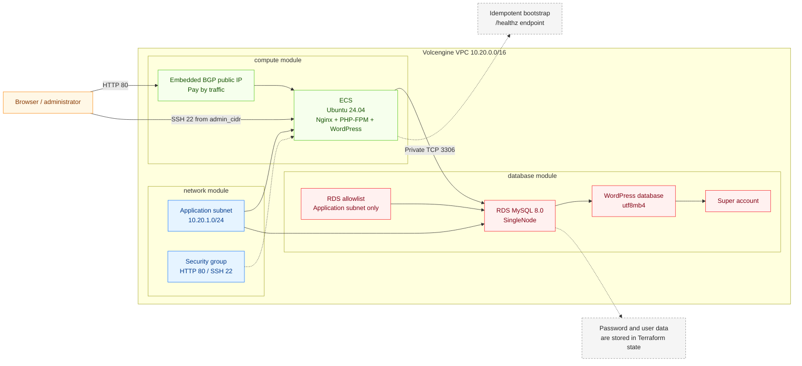

# Quickly Build a WordPress Blog Website

Quickly create a VPC, an ECS web server, and RDS MySQL, automatically install the software required by WordPress, and configure a private database connection. After deployment, create the website administrator through the browser to set up the blog.

## 1. Business Background

Manually creating the network, server, database, and security rules for WordPress commonly causes the following problems:

- **Scattered delivery steps**: VPC, subnet, security group, ECS, RDS, allowlist, and database account settings span multiple console pages and have ordering requirements.
- **Non-reproducible environments**: image, specification, CIDR, and software installation differences cause deployments to diverge.
- **Incomplete cleanup**: an incorrect dependency direction for associated resources such as an RDS allowlist can block destruction.
- **Repeated application setup**: Nginx, PHP-FPM, WordPress, and database connection settings otherwise require manual work on ECS.

Terraform modules create the resources together, and a bootstrap script installs the application and generates its configuration. Initial administrator setup and business verification take place after resource creation.

> This is a demonstration architecture with one ECS instance and a single-node RDS instance. A production system also requires load balancing, multi-zone compute, database redundancy, HTTPS, backup and recovery, monitoring, alerting, and failure exercises.

## 2. Solution Overview

The solution uses a two-tier web and database architecture:

- **Network tier**: creates an isolated VPC, an application subnet, and a security group. Public ingress is limited to HTTP 80 and SSH 22 from `admin_cidr`.
- **Compute tier**: creates one Ubuntu 24.04 ECS instance with an embedded public IP. ECS login uses either a key pair or a password, and cloud-init installs Nginx, PHP-FPM, and a pinned WordPress release.
- **Database tier**: creates single-node RDS MySQL 8.0, a UTF-8 database, an RDS allowlist, and a Super database account.
- **Private access**: WordPress connects to the private RDS endpoint on TCP 3306. Port 3306 is not exposed publicly.
- **Lifecycle**: the allowlist is created first and referenced by RDS through `allow_list_ids`. During destruction, the account, database, and RDS instance are removed before the allowlist.



## 3. IaC Design

### 3.1 Resource Inventory

A complete deployment creates nine Terraform-managed objects: eight Volcengine cloud resources and one destroy-only wait barrier:

| Terraform Resource | Count | Purpose |
| --- | ---: | --- |
| `volcenginecc_vpc_vpc` | 1 | Isolated network boundary for WordPress |
| `volcenginecc_vpc_subnet` | 1 | Application subnet shared by ECS and RDS |
| `volcenginecc_vpc_security_group` | 1 | Allows HTTP 80 and SSH 22 from the configured source |
| `volcenginecc_ecs_instance` | 1 | WordPress web server with a public IP created through `eip_address` |
| `volcenginecc_rdsmysql_allow_list` | 1 | Allows RDS access only from the application subnet |
| `volcenginecc_rdsmysql_instance` | 1 | Single-node, pay-as-you-go MySQL 8.0 |
| `volcenginecc_rdsmysql_database` | 1 | `utf8mb4` WordPress database |
| `volcenginecc_rdsmysql_db_account` | 1 | RDS Super account used by WordPress |
| `time_sleep` | 1 | Waits 60 seconds after ECS deletion before network resources are removed |

Additional details:

- The embedded ECS public IP is created with the instance and has `release_with_instance = true`; it is not a separate Terraform resource.
- The VolcengineCC provider is constrained to `~> 0.0.71`; the destroy barrier uses `hashicorp/time ~> 0.9`.
- The variable defaults and committed one-command configuration use ECS password login. Key-pair login remains available, and Terraform rejects configurations that provide both `key_pair_name` and `ecs_password`.
- The database account type is fixed to `Super`, with more privileges than WordPress usually needs. There is no template input to switch to a normal account.
- The system volume uses `delete_with_instance = true`; media files are stored on that volume. The template does not configure RDS backup retention. Check retained backups during destruction as described in Section 4.2.5.

### 3.2 Project Structure

```text
terraform-volcenginecc-blog-website/
├── modules/
│   ├── network/
│   │   ├── main.tf            # VPC, subnet, and security group
│   │   ├── variables.tf       # Network inputs
│   │   ├── outputs.tf         # Network resource identifiers
│   │   └── versions.tf        # Provider constraints
│   ├── database/
│   │   ├── main.tf            # RDS, allowlist, database, and account
│   │   ├── variables.tf       # Database inputs
│   │   ├── outputs.tf         # Private connection and database identifiers
│   │   └── versions.tf        # Provider constraints
│   └── compute/
│       ├── templates/
│       │   └── wordpress-bootstrap.sh.tftpl  # Application installation template
│       ├── main.tf            # ECS, system volume, and embedded EIP
│       ├── variables.tf       # Compute and application inputs
│       ├── outputs.tf         # Instance and addresses
│       └── versions.tf        # Provider constraints
├── main.tf                    # Module orchestration and destruction wait
├── variables.tf               # Root inputs and validation
├── outputs.tf                 # Website, instance, and database outputs
├── providers.tf               # Provider region configuration
├── versions.tf                # Terraform and provider constraints
├── locals.tf                  # Resource prefix and common tags
├── terraform.tfvars           # Example inputs; review and replace before use
├── README.zh-CN.md             # Chinese instructions
└── README.md                  # English instructions
```

Module dependencies:

```text
network
  ├──> database
  └──> destroy barrier ──> compute <── private database connection details
```

### 3.3 Key Code Examples

The following excerpts from `modules/database/main.tf` show how RDS depends on the allowlist. They are not complete resource definitions that can be deployed independently:

```hcl
resource "volcenginecc_rdsmysql_allow_list" "application" {
  allow_list_name = "${var.resource_prefix}-app-allowlist"
  allow_list      = [var.application_cidr]
}

resource "volcenginecc_rdsmysql_instance" "main" {
  allow_list_ids = [volcenginecc_rdsmysql_allow_list.application.allow_list_id]
}

resource "volcenginecc_rdsmysql_database" "wordpress" {
  instance_id        = volcenginecc_rdsmysql_instance.main.instance_id
  name               = var.database_name
  character_set_name = "utf8mb4"
}

resource "volcenginecc_rdsmysql_db_account" "wordpress" {
  instance_id      = volcenginecc_rdsmysql_instance.main.instance_id
  account_name     = var.account_name
  account_password = var.account_password
  account_type     = "Super"

  depends_on = [volcenginecc_rdsmysql_database.wordpress]
}
```

ECS uses `templatefile()` to render the bootstrap script with the private RDS connection:

```hcl
locals {
  bootstrap_script = templatefile(
    "${path.module}/templates/wordpress-bootstrap.sh.tftpl",
    {
      database_host            = var.database_host
      database_port            = var.database_port
      database_name            = var.database_name
      database_username        = var.database_username
      database_password_base64 = base64encode(var.database_password)
      wordpress_version        = var.wordpress_version
      wordpress_sha256         = var.wordpress_sha256
    }
  )
}
```

The bootstrap script:

- Installs and starts Nginx, PHP-FPM, and the PHP extensions required by WordPress.
- Downloads a pinned WordPress release and verifies its SHA-256 checksum.
- Generates `wp-config.php` and the Nginx site configuration.
- Exposes `/healthz`, where Nginx directly returns `ok`. This endpoint does not execute WordPress or query the database.
- Uses `/var/lib/wordpress-bootstrap.done` to avoid replacing an initialized site.
- Installs Nginx, PHP-FPM, and extensions from Ubuntu repositories without pinning their package versions.
- Does not create the WordPress website administrator; users create it on the installation page.

## 4. Usage

This project supports cloud deployment through InfraManager or local deployment using the downloaded template. Cloud deployment is recommended: you do not need to prepare a Terraform runtime, and you can create and manage resources by entering parameters in the platform.

### 4.1 Cloud Deployment

InfraManager is Volcengine's managed Terraform workspace. For more information, see the [InfraManager product introduction](https://docs.volcengine.com/docs/infrastructure-management/product-introduction?lang=zh).

#### 4.1.1 Prepare Permissions

The Terraform execution identity needs create, read, update, delete, and tag permissions for:

- CloudControl service permissions
- VPC, subnet, and security group
- ECS instance, system volume, login password or key pair reference, and public IP
- RDS MySQL instance, allowlist, database, and account

Follow least privilege and ensure that the platform execution identity can use the project specified by `cloud_project_name`. Confirm pay-as-you-go eligibility, account balance, VPC/ECS/EIP/RDS quotas, and ECS and RDS availability in the same zone. The platform runtime must support Terraform `>= 1.5.7`, `volcengine/volcenginecc ~> 0.0.71`, and `hashicorp/time ~> 0.9`. The last provider implements the destruction wait; confirm that the platform permits it.

#### 4.1.2 Select the Template

Open the [InfraManager console](https://console.volcengine.com/iac), go to **Template Management > Public Templates**, and search for “快速搭建 WordPress 博客网站”.

Confirm in the platform whether this public template has been published. If uploading this project as a custom template, use the platform's custom-template entry point and include the root module, all three `modules/` submodules, and the bootstrap template. The execution directory is the project root.

#### 4.1.3 Create a Stack

Select the template and click **Create Stack**. Enter the stack information and template parameters for your requirements. Create and review the execution plan, then click **Deploy** after confirming the changes are as expected.

The template has 27 root inputs, documented below. Defaults come from `variables.tf`; inputs with no default must be provided. Examples in `terraform.tfvars` are not variable defaults. If the platform loads that file, confirm that parameter-page inputs actually override its examples, particularly `admin_cidr` and both passwords.

| Parameter | Type | Variable Default | Platform Input and Preparation |
| --- | --- | --- | --- |
| `region` | `string` | `cn-beijing` | Confirm the target region; it must match the zone, image, and platform deployment region |
| `zone_id` | `string` | None; required | Select a shared zone for ECS, subnet, and RDS, such as `cn-beijing-a` |
| `project_name` | `string` | `wordpress` | Resource prefix and tag; 3–32 lowercase letters, digits, or hyphens, starting with a letter |
| `environment` | `string` | `demo` | Environment identifier; 2–16 lowercase letters, digits, or hyphens, starting with a letter |
| `owner` | `string` | None; required | Actual owner or team name for the Owner tag |
| `cost_center` | `string` | `shared` | Cost-center tag; follow organizational requirements |
| `cloud_project_name` | `string` | `default` | Existing Volcengine project accessible to the execution identity |
| `vpc_cidr` | `string` | `10.20.0.0/16` | New VPC CIDR; avoid conflicts with networks it will connect to |
| `subnet_cidr` | `string` | `10.20.1.0/24` | Must belong to the VPC; also used as the RDS application-subnet allowlist |
| `admin_cidr` | `string` | None; required | Actual SSH management egress IPv4 `/32` or approved CIDR; do not use the example `0.0.0.0/0` |
| `image_id` | `string` | None; required | Select an Ubuntu 24.04 image compatible with the ECS type from the target region's image list |
| `ecs_instance_type` | `string` | `ecs.g4i.large` | Confirm zone availability and compatibility with the image and system volume |
| `ecs_login_mode` | `string` | `password` | Choose `password` or `key_pair`; the WordPress administrator is a separate identity |
| `key_pair_name` | Nullable `string` | `null` | Existing ECS key-pair name in key-pair mode; set to `null` in password mode |
| `ecs_password` | Sensitive nullable `string` | Plaintext demo default exists; do not reuse | Explicitly enter a new password in password mode; use actual `null` in key-pair mode |
| `ecs_system_volume_type` | `string` | `ESSD_FlexPL` | Confirm that the ECS specification supports this system volume type |
| `ecs_system_volume_size_gb` | `number` | `40` | System volume size in GiB; minimum 40; media files are stored here |
| `eip_bandwidth_mbps` | `number` | `5` | Maximum public bandwidth in Mbps; range 1–200; billed by traffic |
| `rds_node_spec` | `string` | `rds.mysql.c.s.1c2g` | Single-node MySQL specification available in the target zone |
| `rds_storage_space_gb` | `number` | `20` | Database storage in GiB; minimum 20 and must meet specification requirements |
| `rds_deletion_protection` | `bool` | `false` | Keep `false` for demonstrations to be destroyed later; if `true`, disable and apply before destruction |
| `database_name` | `string` | `wordpress` | 2–64 characters, starting with a letter, ending with a letter or digit; letters, digits, underscores, and hyphens allowed |
| `database_username` | `string` | `wordpress_app` | 2–32 characters with the same naming pattern; the template creates a `Super` account |
| `database_password` | Sensitive `string` | Plaintext demo default exists; do not reuse | Enter a new database password in a sensitive platform input; keep it different from the ECS password |
| `wordpress_version` | `string` | `7.1.3` | Three-part version; update the checksum when changing the version |
| `wordpress_sha256` | `string` | Matching archive checksum configured | 64 lowercase hexadecimal SHA-256 characters, matching the selected release archive |
| `additional_tags` | `map(string)` | `{}` | Optional tags; matching keys override standard tags; never include passwords or keys |

The ECS password must be 8–30 characters, contain at least three of uppercase letters, lowercase letters, digits, and special characters, and must not start with `/` or `$6$`. Allowed characters follow the validation in `variables.tf`. The database password must be 8–32 characters and include uppercase letters, lowercase letters, and digits; allowed special characters are `-!@#$%^&*()_+=,.&?|/`.

Password mode requires a non-null `ecs_password` and `key_pair_name = null`. Key-pair mode requires an existing `key_pair_name` and `ecs_password = null`. An empty string or the text `"null"` is not a null value. If the parameter page cannot express null, confirm how inputs are passed before selecting key-pair mode.

You do not need to pre-create or enter VPC, subnet, security-group, ECS, RDS, database, or account resource IDs; the template creates and connects them. The execution role/credentials, stack name, and template source are platform settings, not Terraform root variables above. Enter the website title, administrator, email, and administrator password during browser setup after deployment.

#### 4.1.4 Verify the Deployment

Confirm that the deployment status is successful on the stack details page, then review the template outputs:

| Output | Purpose |
| --- | --- |
| `wordpress_url` | Public HTTP website entry |
| `ecs_instance_id` | Locate the ECS instance and Cloud Assistant target |
| `ecs_private_ip` | Verify the ECS subnet and private database path |
| `ecs_public_ip` | Target for the browser, HTTP, and external SSH checks |
| `rds_instance_id` | Locate the single-node RDS instance |
| `rds_connection_addresses` | Verify private RDS connection records |
| `database_name` | Verify the new WordPress database |
| `database_username` | Verify the application database account, with type Super |
| `wordpress_initialization` | Initial administrator setup guidance |

There are no sensitive outputs. Passwords are not returned as outputs, but are stored in state; the database password also enters ECS user data. Restrict access to stack state and execution records.

In the resource view, verify the ownership of the VPC, subnet, security group, ECS, RDS, database, account, and allowlist. ECS and RDS should share the VPC and subnet; the RDS allowlist should contain only `subnet_cidr`. The embedded EIP and system volume should belong to this ECS instance. Resource counts are described in Section 3.1.

Use the newly returned addresses for the following checks; local state is not required:

1. **Application installation**: run `cloud-init status --long` in this ECS instance's remote terminal. Expect `done` and the file `/var/lib/wordpress-bootstrap.done`. ECS needs outbound access to Ubuntu repositories, WordPress downloads, and the key service. Resource creation does not mean installation is finished. Check cloud-init logs if installation is pending; do not treat HTTP 502 as a passing result.
2. **Entry and application**: open `http://<ecs_public_ip>/healthz` and expect `ok`, then open the installation page or website at `wordpress_url`. `/healthz` only checks the Nginx entry; verify WordPress pages and the database separately.
3. **Admin workflows**: create your website administrator, website title, and email at `/wp-admin/install.php`. Log in at `/wp-admin/`, publish a test post, and upload an image. Open the post and media URLs in a signed-out browser; expect correct content and HTTP 200.
4. **Private database**: run the MySQL command in Section 4.2.4 inside ECS. Obtain the private host, database, and username from platform outputs. If it fails, first check RDS status, the private endpoint, and the application-subnet allowlist.
5. **Recovery and logs**: when brief downtime is permitted, restart application services and ECS. Verify automatic recovery and retained posts and media, then inspect local logs as described in Section 4.2.4.
6. **Public access boundaries**: verify externally that 3306 and unnecessary management ports cannot be reached. SSH 22 should be reachable from the actual `admin_cidr` source and unreachable from other sources. Use real positive and negative requests, not only configuration or an egress-IP website. Configure the domain and HTTPS separately before testing them.

### 4.2 Local Deployment

You can also download and run the template locally by following the steps below. Run Terraform commands in the project root; run system and application commands inside the ECS instance identified by the outputs.

#### 4.2.1 Prepare the Environment

**Base environment**: install Terraform `>= 1.5.7` and allow access to Terraform Registry. Provider constraints are `volcengine/volcenginecc ~> 0.0.71` and `hashicorp/time ~> 0.9`. The project does not ship a root-module lock file; initialization selects versions within those ranges. Retain the generated lock file and review dependencies for reproducibility.

**Permissions and quotas**: prepare service permissions, quotas, and capacity in the console as described in Section 4.1.1. Confirm the Ubuntu 24.04 image and ECS/RDS types available in the same zone. Create or select an existing key pair before choosing key-pair mode.

**Credential injection** (environment variables are recommended; do not store credentials in code or `tfvars`):

```bash
export VOLCENGINE_ACCESS_KEY="your_access_key"
export VOLCENGINE_SECRET_KEY="your_secret_key"
export VOLCENGINE_REGION="cn-beijing"
```

The provider explicitly uses `var.region` in `providers.tf`, so that input determines the deployment region. Keep the environment region consistent; do not assume it overrides the input.

**Sensitive business variables**: `ecs_password` is the initial ECS administrator password, and `database_password` is the application database password. Both are sensitive. Inject them through environment variables instead of storing them in `terraform.tfvars`:

```bash
export TF_VAR_ecs_password="<new_ecs_password>"
export TF_VAR_database_password="<new_database_password>"
```

The current `terraform.tfvars` contains assignments for both demo passwords. Values from `tfvars` take precedence over `TF_VAR_*`. Remove these assignments from your deployment parameter file before using the injections above, and confirm that the intended passwords are used. Exporting variables alone will not override existing `tfvars`. Never commit real passwords. State, plans, and user data may contain sensitive content; protect local files or the platform backend.

**Key parameters**: all 27 inputs and password rules are listed in Section 4.1.3. Replace `zone_id`, `owner`, `image_id`, and `admin_cidr`, and review specifications, CIDRs, and both passwords. The current example's unrestricted SSH and demo passwords are not safe defaults.

#### 4.2.2 Scenario-based Deployment Examples

Initialize and validate:

```bash
terraform init
terraform fmt -check -recursive
terraform validate
```

**Scenario one: a demonstration website with password login.** Enter the region, zone, image, management CIDR, and specifications from Section 4.1.3 in your `terraform.tfvars`, with the following non-sensitive login settings. Inject both passwords through environment variables and remove password assignments from the parameter file.

```hcl
ecs_login_mode = "password"
key_pair_name  = null
```

Generate, review, and apply a plan:

```bash
terraform plan -out=wordpress.tfplan
terraform show wordpress.tfplan
terraform apply wordpress.tfplan
```

A new environment should create the resources in Section 3.1 and use the supplied ECS login password. Website administrator setup remains a separate step. Review any unintended replacement or deletion before applying.

**Scenario two: login with an existing key pair.** Before initial deployment, switch to these login settings. `ecs_password = null` cancels the demo default in the source code; continue injecting the database password through the environment. The architecture of the other resources stays the same.

```hcl
ecs_login_mode = "key_pair"
key_pair_name  = "your-existing-key-pair"
ecs_password   = null
```

```bash
terraform plan -out=wordpress.tfplan
terraform show wordpress.tfplan
terraform apply wordpress.tfplan
```

Review the plan before changing an existing instance's login mode, image, zone, or CIDR; the provider plan determines replacements. Updating the WordPress release and checksum will not automatically rerun cloud-init on an existing instance and must not be treated as a completed application upgrade.

#### 4.2.3 Expected Deployment Results

A new environment creates eight cloud resources and one destruction-wait object. ECS creates the EIP and system volume as embedded components, as described in Section 3.1. View outputs with:

```bash
terraform output
```

See Section 4.1.4 for all output meanings. Use the public address for the new website and the private addresses to verify the ECS-to-RDS path. Check application installation separately.

#### 4.2.4 Post-deployment Verification

First obtain the target addresses through local `terraform output` and follow Section 4.1.4 for resources, website setup, and actual publication/uploads. The commands below provide additional internal ECS checks. Use authorized SSH, a console remote terminal, or an installed Cloud Assistant. The template sets `install_run_command_agent = false`; do not assume every image includes Cloud Assistant.

**Installation and services**: run inside ECS. Expect completed initialization, the marker file, and active Nginx and the detected PHP-FPM service:

```bash
cloud-init status --long
sudo test -f /var/lib/wordpress-bootstrap.done
php_fpm_service=$(systemctl list-unit-files --type=service --no-legend | awk '/^php[0-9.]+-fpm.service / {print $1}' | sort -V | tail -n 1)
test -n "$php_fpm_service"
systemctl is-active nginx "$php_fpm_service"
systemctl is-enabled nginx "$php_fpm_service"
```

**Private SQL**: replace the following three placeholders with the new deployment's outputs and run inside ECS. Enter the database password at the terminal prompt instead of putting it in the command:

```bash
mysql --connect-timeout=5 \
  --host="<rds_private_host>" --port=3306 \
  --user="<database_username>" --password "<database_name>" \
  --execute='SELECT VERSION(), DATABASE(), CURRENT_USER();'
```

Expect the MySQL version, application database, and actual account. If connection fails, check private 3306 and the allowlist first; if authentication fails, check the account and password.

**Recovery and logs**: record the public URLs of a published post and image. When brief downtime is acceptable, run `sudo systemctl restart nginx "$php_fpm_service"` inside ECS, then restart the instance from the ECS console. After recovery, verify the services and public content. PHP-FPM executes WordPress; there is no separate WordPress systemd service.

Installation logs are `/var/log/cloud-init.log` and `/var/log/cloud-init-output.log`. Web logs are `/var/log/nginx/access.log` and `/var/log/nginx/error.log`. Inspect PHP-FPM's service logs and `journalctl`. Interpret Fatal errors, installation failures, and request errors using their time and context; a failure string printed as script source is not an execution failure. Logs should not contain plaintext passwords. The template does not enable the independent WordPress `wp-content/debug.log`. Configure it separately if needed, without displaying errors to visitors or permitting public log downloads.

**Deployment convergence**: run in the local project directory:

```bash
terraform plan
```

Expect `No changes. Your infrastructure matches the configuration.` Remove test posts and images through the admin interface when appropriate, after confirming they are test data.

Local verification of the same code covered private SQL, real posts and media, service and instance restart recovery, repeated initialization with the completion marker present, a second plan, and existing logs. Local results do not replace initial deployment verification in a new platform stack. Verify the required two-source SSH comparison and independent WordPress log separately.

#### 4.2.5 Destroy Resources

Back up WordPress content and the database before destruction. If `rds_deletion_protection` is enabled, set it to `false` and apply that change first.

Locally, use the original deployment directory and state. In the cloud, delete from the same resource stack after reviewing its plan; do not upload local acceptance state into a new platform stack. Destruction includes a 60-second wait after ECS deletion for the primary ENI and security-group association to be released before network deletion.

```bash
terraform plan -destroy
terraform destroy
```

Destruction removes media on the ECS system volume and website data in RDS. After completion, `terraform state list` should return no output. Independently check the original ECS, EIP, system volume, ENI, RDS, allowlist, and network resource IDs in the console. Existing key pairs are supplied by the caller and are not deleted with the template.

RDS deletion may retain the last backup for seven days by default. This policy has no template input, and successful Terraform execution does not mean backups are empty. Inspect retained data in the RDS deleted-instance/backup interface. If no longer needed, use the supported product deletion action for that instance's backups and verify the list again. Distinguish platform recycle-history records from restorable backups. Retain independent check results for audit; historical usage may appear after billing settlement.

Local destruction of the same code released resources and associations; backups were confirmed empty after additional deletion of retained backups. This does not guarantee that `terraform destroy` alone will empty backups in a new deployment.

## 5. Summary

- Three modules manage networking, ECS, RDS, the database, and application connectivity.
- Dependency installation and WordPress archive verification are automated, with a completion marker protecting initialized website configuration.
- Intended for a single-zone demonstration and non-critical functional validation. Prepare administrator setup, HTTPS, independent application logging, and production operations separately.
