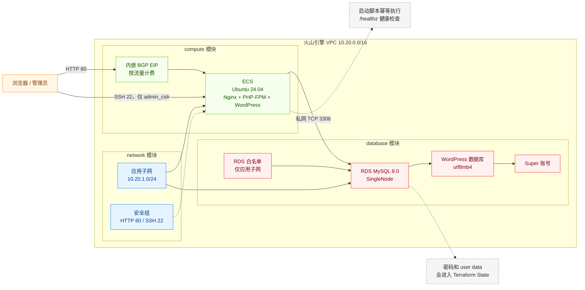

# 快速搭建 WordPress 博客网站

快速创建 VPC、ECS Web 服务器和 RDS MySQL，自动安装 WordPress 所需的软件并配置私网数据库连接，部署完成后通过网页创建站点管理员，搭建博客网站。

## 1. 业务背景

快速搭建 WordPress 时，手工创建网络、云服务器、数据库和安全规则通常会带来以下问题：

- **交付步骤分散**：VPC、子网、安全组、ECS、RDS、白名单和数据库账号需要跨控制台配置，容易遗漏依赖。
- **环境难以复现**：镜像、规格、网段和软件安装过程不一致，测试环境与后续部署容易产生差异。
- **资源回收不完整**：RDS 白名单等关联资源的依赖方向不正确时，销毁可能因资源仍被占用而失败。
- **业务初始化重复**：Nginx、PHP-FPM、WordPress 和数据库连接配置需要在 ECS 上手工执行。

本项目通过 Terraform 模块统一创建资源，并用启动脚本安装应用、生成配置；管理员首次创建和实际业务验证在资源创建后进行。

> 本方案是单 ECS、单节点 RDS 的演示架构，不属于高可用生产架构。生产环境还需要负载均衡、多可用区计算、数据库高可用、HTTPS、备份恢复、监控告警和故障演练。

## 2. 方案概述

整体采用 Web 与数据库分离的两层架构：

- **网络层**：创建独立 VPC、应用子网和安全组。公网仅开放 HTTP 80，以及 `admin_cidr` 指定来源的 SSH 22。
- **计算层**：创建一台 Ubuntu 24.04 ECS，并通过内嵌 EIP 提供公网访问。ECS 登录凭证支持密钥对或密码互斥选择，cloud-init 安装 Nginx、PHP-FPM 和固定版本 WordPress。
- **数据库层**：创建单节点 RDS MySQL 8.0、UTF-8 数据库、RDS 白名单和 Super 数据库账号。
- **私网访问**：WordPress 通过 RDS 私网地址和 TCP 3306 访问数据库，3306 不对公网开放。
- **生命周期**：白名单先创建，RDS 通过 `allow_list_ids` 引用白名单；销毁时先删除账号、数据库和 RDS，再删除白名单。



## 3. IaC 设计

### 3.1 资源清单

完整部署共创建 9 个 Terraform 管理对象：8 个火山引擎云资源和 1 个仅用于销毁等待的 barrier：

| Terraform 资源 | 数量 | 用途 |
| --- | ---: | --- |
| `volcenginecc_vpc_vpc` | 1 | WordPress 独立网络边界 |
| `volcenginecc_vpc_subnet` | 1 | ECS 与 RDS 共用的应用子网 |
| `volcenginecc_vpc_security_group` | 1 | 放行 HTTP 80 和指定来源的 SSH 22 |
| `volcenginecc_ecs_instance` | 1 | WordPress Web 服务器，并通过 `eip_address` 内嵌创建公网 IP |
| `volcenginecc_rdsmysql_allow_list` | 1 | 仅允许应用子网访问 RDS |
| `volcenginecc_rdsmysql_instance` | 1 | 单节点、按量付费的 MySQL 8.0 |
| `volcenginecc_rdsmysql_database` | 1 | `utf8mb4` WordPress 数据库 |
| `volcenginecc_rdsmysql_db_account` | 1 | WordPress 使用的 RDS Super 账号 |
| `time_sleep` | 1 | ECS 删除后等待 60 秒，再删除网络资源 |

补充说明：

- ECS 内嵌 EIP 随实例创建，并设置 `release_with_instance = true`，因此不是独立 Terraform 资源。
- VolcengineCC Provider 约束 `~> 0.0.71`；销毁 barrier 使用 `hashicorp/time ~> 0.9`。
- ECS 登录变量默认值和仓库提交的一键启动配置均使用密码模式；仍可切换为密钥对模式，Terraform 会拒绝同时配置 `key_pair_name` 和 `ecs_password`。
- 数据库账号固定为 `Super`，权限高于 WordPress 通常需要的范围；当前模板没有切换为普通账号的输入参数。
- 系统盘设置 `delete_with_instance = true`；媒体位于 ECS 系统盘。RDS 的备份保留策略没有在模板中设置，销毁时须按第 4.2.5 节核对保留备份。

### 3.2 工程结构

```text
terraform-volcenginecc-blog-website/
├── modules/
│   ├── network/
│   │   ├── main.tf            # VPC、子网、安全组
│   │   ├── variables.tf       # 网络输入
│   │   ├── outputs.tf         # 网络资源标识
│   │   └── versions.tf        # Provider 约束
│   ├── database/
│   │   ├── main.tf            # RDS、白名单、数据库、账号
│   │   ├── variables.tf       # 数据库输入
│   │   ├── outputs.tf         # 私网连接与数据库标识
│   │   └── versions.tf        # Provider 约束
│   └── compute/
│       ├── templates/
│       │   └── wordpress-bootstrap.sh.tftpl  # 应用安装脚本模板
│       ├── main.tf            # ECS、系统盘、内嵌 EIP
│       ├── variables.tf       # 计算与应用输入
│       ├── outputs.tf         # 实例及地址
│       └── versions.tf        # Provider 约束
├── main.tf                    # 模块编排与销毁等待
├── variables.tf               # 根模块输入与校验
├── outputs.tf                 # 站点、实例及数据库输出
├── providers.tf               # Provider 地域配置
├── versions.tf                # Terraform 与 Provider 约束
├── locals.tf                  # 资源名前缀与公共标签
├── terraform.tfvars           # 示例参数，使用前审查并替换
├── README.zh-CN.md             # 中文使用说明
└── README.md                  # 英文使用说明
```

模块依赖关系：

```text
network
  ├──> database
  └──> destroy barrier ──> compute <── database 私网连接信息
```

### 3.3 核心代码示例

以下节选自 `modules/database/main.tf`，展示 RDS 引用白名单的依赖关系；它不是单独可部署的完整资源定义：

```hcl
resource "volcenginecc_rdsmysql_allow_list" "application" {
  allow_list_name = "${var.resource_prefix}-app-allowlist"
  allow_list      = [var.application_cidr]
}

resource "volcenginecc_rdsmysql_instance" "main" {
  allow_list_ids = [volcenginecc_rdsmysql_allow_list.application.allow_list_id]
}

resource "volcenginecc_rdsmysql_database" "wordpress" {
  instance_id        = volcenginecc_rdsmysql_instance.main.instance_id
  name               = var.database_name
  character_set_name = "utf8mb4"
}

resource "volcenginecc_rdsmysql_db_account" "wordpress" {
  instance_id      = volcenginecc_rdsmysql_instance.main.instance_id
  account_name     = var.account_name
  account_password = var.account_password
  account_type     = "Super"

  depends_on = [volcenginecc_rdsmysql_database.wordpress]
}
```

ECS 通过 `templatefile()` 获取 RDS 私网连接参数并渲染启动脚本：

```hcl
locals {
  bootstrap_script = templatefile(
    "${path.module}/templates/wordpress-bootstrap.sh.tftpl",
    {
      database_host            = var.database_host
      database_port            = var.database_port
      database_name            = var.database_name
      database_username        = var.database_username
      database_password_base64 = base64encode(var.database_password)
      wordpress_version        = var.wordpress_version
      wordpress_sha256         = var.wordpress_sha256
    }
  )
}
```

启动脚本具有以下行为：

- 安装并启动 Nginx、PHP-FPM 和 WordPress 所需扩展。
- 下载固定版本 WordPress 并校验 SHA-256。
- 自动生成 `wp-config.php` 和 Nginx 站点配置。
- 提供由 Nginx 直接返回 `ok` 的 `/healthz` 入口检查，它不会执行 WordPress 或查询数据库。
- 使用 `/var/lib/wordpress-bootstrap.done` 避免重复覆盖已有站点。
- 通过 Ubuntu 软件仓库安装 Nginx、PHP-FPM 及扩展，未锁定其软件包版本。
- 不创建 WordPress 网页管理员；首次访问安装页时由使用者创建。

## 4. 使用说明

本工程支持通过 InfraManager 在云上一键部署或下载模板在本地运行。推荐使用云上部署方式，无需自行准备 Terraform 运行环境，只需在平台填写参数即可完成资源创建和托管。

### 4.1 云上部署

InfraManager 是火山引擎提供的 Terraform 托管工作台，更多产品介绍参见 [InfraManager 产品介绍](https://docs.volcengine.com/docs/infrastructure-management/product-introduction?lang=zh)。

#### 4.1.1 准备权限

Terraform 执行身份需要具备以下资源的创建、查询、更新、删除和标签管理权限：

- CloudControl 服务权限
- VPC、子网和安全组
- ECS 实例、系统盘、登录密码或密钥对引用，以及公网 IP
- RDS MySQL 实例、白名单、数据库和账号

遵循最小权限原则，并确认平台执行身份能够使用 `cloud_project_name` 指定的项目。还需在控制台确认按量付费资格、账户余额、VPC／ECS／EIP／RDS 配额，以及同一可用区的 ECS 和 RDS 规格库存。平台运行环境须支持 Terraform `>= 1.5.7`、`volcengine/volcenginecc ~> 0.0.71` 和 `hashicorp/time ~> 0.9`；后者用于销毁等待，需要确认平台允许使用。

#### 4.1.2 选择模板

打开 [InfraManager 控制台](https://console.volcengine.com/iac)，进入 **模板管理 > 公开模板**，搜索“快速搭建 WordPress 博客网站”。

公开模板是否已发布须在平台确认。若准备上传本工程作为自定义模板，应使用平台提供的自定义模板入口，包含根模块、三个 `modules/` 子模块和启动脚本模板；执行目录为工程根目录。

#### 4.1.3 创建资源栈

选择模板并点击 **创建资源栈**，根据实际需求填写资源栈信息和模板参数。创建并检查执行计划，确认变更符合预期后，点击 **执行部署**。

本模板有 27 个根模块输入，完整说明如下。“默认”来自 `variables.tf`；无默认值的参数必须输入，`terraform.tfvars` 中的示例不等于变量默认值。平台若加载该文件，应确认页面输入确实覆盖示例值，尤其是 `admin_cidr` 和两个密码。

| 参数 | 类型 | 变量默认值 | 平台填写与准备 |
| --- | --- | --- | --- |
| `region` | `string` | `cn-beijing` | 确认目标地域；须与可用区、镜像和平台部署地域一致 |
| `zone_id` | `string` | 无，必填 | 选择 ECS、子网和 RDS 共用的可用区，例如 `cn-beijing-a` |
| `project_name` | `string` | `wordpress` | 资源命名前缀与标签；3–32 个小写字母、数字或连字符，以字母开头 |
| `environment` | `string` | `demo` | 环境标识；2–16 个小写字母、数字或连字符，以字母开头 |
| `owner` | `string` | 无，必填 | 填实际负责人或团队名称，用于 Owner 标签 |
| `cost_center` | `string` | `shared` | 成本中心标签，按组织要求填写 |
| `cloud_project_name` | `string` | `default` | 已存在且执行身份有权限使用的火山引擎项目 |
| `vpc_cidr` | `string` | `10.20.0.0/16` | 新 VPC 网段；确认不与待互通网络冲突 |
| `subnet_cidr` | `string` | `10.20.1.0/24` | 须位于 VPC 内；同时作为 RDS 应用子网白名单 |
| `admin_cidr` | `string` | 无，必填 | 实际 SSH 管理出口的 IPv4 `/32` 或已授权网段；不要使用示例中的 `0.0.0.0/0` |
| `image_id` | `string` | 无，必填 | 从目标地域 ECS 镜像列表选择适配规格的 Ubuntu 24.04 镜像 |
| `ecs_instance_type` | `string` | `ecs.g4i.large` | 确认目标可用区库存，并与镜像、系统盘类型匹配 |
| `ecs_login_mode` | `string` | `password` | 选择 `password` 或 `key_pair`；部署后 WordPress 管理员是另一套身份 |
| `key_pair_name` | `string`，可空 | `null` | 密钥模式填已有 ECS 密钥对名称；密码模式设为 `null` |
| `ecs_password` | 敏感 `string`，可空 | 有明文演示默认值，不应沿用 | 密码模式显式输入新密码；密钥模式必须设为真正的 `null` |
| `ecs_system_volume_type` | `string` | `ESSD_FlexPL` | 确认 ECS 规格支持的系统盘类型 |
| `ecs_system_volume_size_gb` | `number` | `40` | 系统盘容量，GiB；至少 40；媒体文件存储于此 |
| `eip_bandwidth_mbps` | `number` | `5` | 公网峰值带宽，Mbps；范围 1–200，按流量计费 |
| `rds_node_spec` | `string` | `rds.mysql.c.s.1c2g` | 目标可用区可用的单节点 MySQL 规格 |
| `rds_storage_space_gb` | `number` | `20` | 数据库存储，GiB；至少 20，并满足所选规格要求 |
| `rds_deletion_protection` | `bool` | `false` | 演示结束后要销毁可保持 `false`；若设 `true`，销毁前需先关闭并应用 |
| `database_name` | `string` | `wordpress` | 2–64 位，字母开头、字母或数字结尾，中间允许字母、数字、下划线和连字符 |
| `database_username` | `string` | `wordpress_app` | 2–32 位，同类命名约束；模板创建 `Super` 账号 |
| `database_password` | 敏感 `string` | 有明文演示默认值，不应沿用 | 在平台敏感输入中填新的数据库密码；与 ECS 密码分别设置 |
| `wordpress_version` | `string` | `7.1.3` | 三段版本号；更换版本时必须同步校验值 |
| `wordpress_sha256` | `string` | 已配置对应归档校验值 | 64 位小写十六进制 SHA-256；与所选版本压缩包匹配 |
| `additional_tags` | `map(string)` | `{}` | 可选附加标签；同名键会覆盖标准标签，勿填密码或密钥 |

ECS 密码为 8–30 位，须含大写字母、小写字母、数字、特殊字符中至少三类，且不能以 `/` 或 `$6$` 开头；允许字符以 `variables.tf` 的校验为准。数据库密码为 8–32 位，必须含大写字母、小写字母和数字；允许的特殊字符为 `-!@#$%^&*()_+=,.&?|/`。

密码模式要求 `ecs_password` 非空且 `key_pair_name = null`；密钥模式要求已有 `key_pair_name` 且 `ecs_password = null`。空字符串和文本 `"null"` 都不等于 `null`。如果平台页面不能表达空值，先确认它如何传递参数，再使用密钥模式。

不用提前创建或填写 VPC、子网、安全组、ECS、RDS、数据库及账号的资源 ID，模板会创建并传递它们。平台执行角色／凭证、资源栈名称、模板来源属于平台配置，不是上述 Terraform 根变量。WordPress 站点名称、管理员、邮箱和管理员密码在部署后的网页初始化中填写。

#### 4.1.4 部署验证

在资源栈详情页查看部署状态为“成功”，再查看模板输出：

| 输出 | 用途 |
| --- | --- |
| `wordpress_url` | 公网 HTTP 站点入口 |
| `ecs_instance_id` | 定位 ECS 实例及云助手目标 |
| `ecs_private_ip` | 核对 ECS 所属子网和数据库私网路径 |
| `ecs_public_ip` | 浏览器、HTTP 和外部 SSH 探测目标 |
| `rds_instance_id` | 定位单节点 RDS |
| `rds_connection_addresses` | 核对 RDS 私网连接记录 |
| `database_name` | 核对新建的 WordPress 数据库 |
| `database_username` | 核对应用数据库账号，类型为 Super |
| `wordpress_initialization` | 首次管理员初始化页面提示 |

当前没有敏感 Output；密码不会作为输出展示，但会进入 State，数据库密码也进入 ECS user data。限制资源栈 State 和执行记录的访问权限。

在资源页核对 VPC、子网、安全组、ECS、RDS、数据库、账号和白名单的归属；ECS 与 RDS 应在同一 VPC 和子网，RDS 白名单仅为 `subnet_cidr`。嵌套 EIP 和系统盘应绑定该 ECS；资源数量说明见第 3.1 节。

使用输出中的新地址执行以下验证，不需要本地 State：

1. **应用安装**：在该 ECS 远程终端执行 `cloud-init status --long`，应为 `done`，且 `/var/lib/wordpress-bootstrap.done` 存在。ECS 需能出网访问 Ubuntu 软件仓库、WordPress 下载站和密钥服务。资源创建完成不等于安装完成；安装未结束先查 cloud-init 日志，不把 HTTP 502 直接算作通过。
2. **入口和应用**：浏览器打开 `http://<ecs_public_ip>/healthz`，预期 `ok`；再打开 `wordpress_url` 的安装页或站点。`/healthz` 只证明 Nginx 入口可用，WordPress 实际页面和数据库还需验证。
3. **后台业务**：在 `/wp-admin/install.php` 创建自己的站点管理员、站点名称与邮箱。登录 `/wp-admin/`，发布一篇测试文章、上传一张图片；从未登录浏览器打开文章和媒体 URL，预期正文及图片正常、HTTP 200。
4. **私网数据库**：在 ECS 内按第 4.2.4 节的 MySQL 命令验证，数据库地址、库名、账号从平台输出取得。失败先查 RDS 运行状态、私网端点和应用子网白名单。
5. **恢复与日志**：允许短暂中断时重启应用服务和 ECS，确认服务自动恢复、文章与媒体仍可访问；再按第 4.2.4 节检查本机日志。
6. **公网访问边界**：从外部网络确认 3306 和非必要管理端口不可达。SSH 22 应从 `admin_cidr` 实际来源可达、其他来源不可达；需要实际正反向请求，不能只看规则或出口查询网站。域名和 HTTPS 需另行配置后验证。

### 4.2 本地部署

您也可以下载本工程模板在本地运行，需要按照下述步骤操作。下面的 Terraform 命令在工程根目录执行；系统与应用命令在输出指向的 ECS 内执行。

#### 4.2.1 环境准备

**基础环境**：安装 Terraform `>= 1.5.7`，能够访问 Terraform Registry；Provider 约束为 `volcengine/volcenginecc ~> 0.0.71`、`hashicorp/time ~> 0.9`。工程未交付根模块锁文件，首次初始化会在版本范围内选择版本；为部署可复现，应保存初始化生成的锁文件并审查依赖。

**权限与配额**：按第 4.1.1 节在控制台准备服务权限、额度和库存，确认 Ubuntu 24.04 镜像与同一可用区的 ECS、RDS 规格。密钥模式先创建或选择已有密钥对。

**凭证注入**（推荐环境变量，不要写入代码或 `tfvars`）：

```bash
export VOLCENGINE_ACCESS_KEY="your_access_key"
export VOLCENGINE_SECRET_KEY="your_secret_key"
export VOLCENGINE_REGION="cn-beijing"
```

Provider 在 `providers.tf` 中显式使用 `var.region`，因此部署地域以该参数为准；环境变量地域也应保持一致，不能认为它会覆盖参数。

**敏感业务变量**：`ecs_password` 为 ECS 初始管理员密码，`database_password` 为应用数据库密码；两者都是敏感字段，建议通过环境变量注入，不要写入 `terraform.tfvars`：

```bash
export TF_VAR_ecs_password="<new_ecs_password>"
export TF_VAR_database_password="<new_database_password>"
```

当前 `terraform.tfvars` 已含这两个演示密码参数，同名 `tfvars` 值优先于 `TF_VAR_*`。使用上述注入前，先从你的部署参数文件删除这两项赋值，并确认密码输入实际生效；仅导出变量不会覆盖现有 `tfvars`。实际密码不得提交到仓库。State、Plan 和 user data 可能含敏感内容，须保护本地文件或平台 Backend。

**重点参数**：完整 27 项及密码规则见第 4.1.3 节。部署前替换 `zone_id`、`owner`、`image_id`、`admin_cidr`，复核规格、网段和两个密码。当前示例的全网 SSH 和演示密码不能作为安全默认值。

#### 4.2.2 场景化部署示例

初始化与校验：

```bash
terraform init
terraform fmt -check -recursive
terraform validate
```

**场景一：密码登录演示站点。**在你的 `terraform.tfvars` 中填写第 4.1.3 节的地域、可用区、镜像、管理网段和规格，设置以下非敏感登录模式；两个密码通过环境变量注入，参数文件中不要保留密码赋值。

```hcl
ecs_login_mode = "password"
key_pair_name  = null
```

生成、审查并执行计划：

```bash
terraform plan -out=wordpress.tfplan
terraform show wordpress.tfplan
terraform apply wordpress.tfplan
```

新环境预期创建第 3.1 节的资源，ECS 使用输入密码登录；管理员网页初始化另行完成。执行前检查计划中的任何非预期替换或删除。

**场景二：已有密钥对登录。**首次部署前将登录参数改为以下配置；`ecs_password = null` 用来取消源码中的演示默认值，数据库密码仍通过环境变量输入。其他资源保持同类架构。

```hcl
ecs_login_mode = "key_pair"
key_pair_name  = "your-existing-key-pair"
ecs_password   = null
```

```bash
terraform plan -out=wordpress.tfplan
terraform show wordpress.tfplan
terraform apply wordpress.tfplan
```

已有实例切换登录方式、镜像、可用区或网段前先看计划，是否替换以 Provider 计划为准；更换 WordPress 版本和校验值不会自动重新执行已有实例的 cloud-init，不应把参数修改当作应用升级已完成。

#### 4.2.3 部署预期结果

新环境预期创建 8 个云资源和 1 个销毁等待对象；EIP 与系统盘由 ECS 嵌套创建，见第 3.1 节。通过以下命令查看输出：

```bash
terraform output
```

全部输出含义见第 4.1.4 节。输出中的公网地址用于访问新站点，私网地址用于核对 ECS 到 RDS 的路径；应用安装仍需单独检查。

#### 4.2.4 部署后验证

先在本地通过 `terraform output` 取得第 4.1.4 节的目标地址，再按该节完成资源、网页初始化和实际发布上传验证。以下补充 ECS 内部的检查命令，可在已授权 SSH、控制台远程终端或已安装云助手中执行；模板设置 `install_run_command_agent = false`，不能假定所有镜像都有云助手。

**安装与服务**：在 ECS 上执行，预期初始化完成、标记存在，Nginx 和自动识别的 PHP-FPM 服务为 active：

```bash
cloud-init status --long
sudo test -f /var/lib/wordpress-bootstrap.done
php_fpm_service=$(systemctl list-unit-files --type=service --no-legend | awk '/^php[0-9.]+-fpm.service / {print $1}' | sort -V | tail -n 1)
test -n "$php_fpm_service"
systemctl is-active nginx "$php_fpm_service"
systemctl is-enabled nginx "$php_fpm_service"
```

**私网 SQL**：在 ECS 中将以下三项占位值换成新部署的输出。通过终端提示输入数据库密码，不把密码写入命令：

```bash
mysql --connect-timeout=5 \
  --host="<rds_private_host>" --port=3306 \
  --user="<database_username>" --password "<database_name>" \
  --execute='SELECT VERSION(), DATABASE(), CURRENT_USER();'
```

预期返回 MySQL 版本、应用库和实际账号；若连接失败，先查私网3306和白名单；若鉴权失败，再查账号和密码。

**恢复与日志**：先记下已发布文章和图片的公开 URL。允许短暂中断时在 ECS 执行 `sudo systemctl restart nginx "$php_fpm_service"`，再从 ECS 控制台重启实例；恢复后复查服务和公开内容。WordPress 由 PHP-FPM 执行，没有单独的 WordPress systemd 服务。

安装日志位于 `/var/log/cloud-init.log`、`/var/log/cloud-init-output.log`；Web 日志位于 `/var/log/nginx/access.log`、`/var/log/nginx/error.log`，PHP-FPM 通过相应服务日志和 `journalctl` 查看。检查 Fatal、实际安装失败和请求错误时结合时间和上下文判断，不将脚本正文里的失败字符串直接算作执行失败；日志中不应出现明文密码。WordPress 独立 `wp-content/debug.log` 未由模板启用，若需独立应用错误记录要另行配置，且不要向访客显示错误或开放日志下载。

**部署收敛**：在本地工程目录运行：

```bash
terraform plan
```

预期为 `No changes. Your infrastructure matches the configuration.`。测试文章和图片在管理后台按需删除，删除前确认仅为测试数据。

同版本地验收已覆盖私网SQL、实际文章与媒体、服务和实例重启恢复、完成标记存在时的重复初始化、二次Plan及现有日志检查。本地结果不替代平台新资源栈的首次部署验证，SSH两来源对照和WordPress独立日志仍需按所需范围另行验证。

#### 4.2.5 销毁资源

销毁前备份 WordPress 内容和数据库。若启用了 `rds_deletion_protection`，先将其改为 `false` 并执行一次 Apply。

在本地使用原部署目录和 State；云上从同一资源栈执行删除并审查计划，不要把本地验收 State 上传到新平台资源栈。ECS 删除后包含 60 秒等待，用于等待主网卡及其安全组关联释放，再删除网络资源。

```bash
terraform plan -destroy
terraform destroy
```

销毁会删除 ECS 系统盘上的媒体和 RDS 中的站点内容。完成后运行 `terraform state list` 应无输出，并在控制台按原资源 ID 独立检查 ECS、EIP、系统盘、网卡、RDS、白名单和网络资源。已有密钥对由调用方提供，不会随本模板删除。

RDS 删除默认可能保留最后一份备份 7 天；该策略没有对应的模板输入，Terraform 退出成功不表示备份已清空。在 RDS 的已删除实例／备份入口检查保留数据；如不需要，按产品支持的删除入口清理该实例备份，并复查列表。平台保留的已回收历史记录与可恢复备份分开判断。若需审计，保留独立核查结果；历史用量仍可能在账单结算后显示。

同版本地销毁曾完成资源及关联对象释放，并在额外删除保留备份后确认备份为空；不能据此承诺新的部署仅执行 `terraform destroy` 就自动清空备份。

## 5. 总结

- 用三个模块统一管理网络、ECS、RDS、数据库和应用连接。
- 自动安装依赖、验证 WordPress 下载文件并避免覆盖已完成初始化的站点配置。
- 面向单可用区演示和非关键功能验证；管理员初始化、HTTPS、独立应用日志及生产运维能力另行准备。
